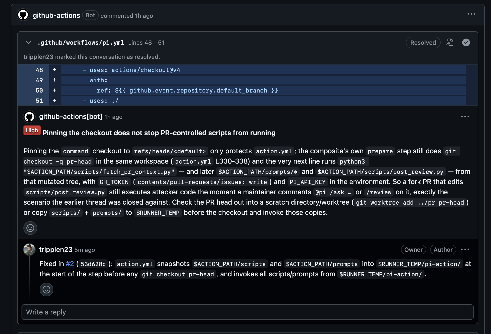

<div align="center">

<br />

<picture>
  <source media="(prefers-color-scheme: dark)" srcset="https://raw.githubusercontent.com/tripplen23/huggy-pr-agent/main/assets/banner-dark.svg" />
  <source media="(prefers-color-scheme: light)" srcset="https://raw.githubusercontent.com/tripplen23/huggy-pr-agent/main/assets/banner-light.svg" />
  
</picture>

<p><strong>Repository-aware pull request reviews and <code>@huggy</code> fixes, powered by Pi.</strong></p>

[](https://www.npmjs.com/package/huggy-pr-agent)
[](https://github.com/tripplen23/huggy-pr-agent/actions/workflows/ci.yml)
[](https://github.com/tripplen23/huggy-pr-agent/releases)
[](LICENSE)

[Quick Start](#quick-start) · [Providers & Vertex AI](#model-providers--google-vertex-ai) · [Commands](#commands--capabilities) · [How It Works](#how-it-works) · [Configuration](#configuration--inputs) · [Agent Install Spec](https://github.com/tripplen23/huggy-pr-agent/blob/main/INSTALL.md)

</div>

---

## Preview

While a review pipeline is running, Huggy shows a compact pixel-art status indicator, then replaces it with a clean summary and inline diff comments once finished:

<div align="center">
  
</div>

<br />

<div align="center">
  
</div>

---

## Quick Start

### Option A — Install as a Pi Package or Cross-Harness Skill

Use Huggy locally inside your terminal **and** set up GitHub Actions in one command:

```bash
# In Pi (adds /huggy review, /huggy review deep, /huggy setup, /huggy sync, and huggy_prepare_diff):
pi install npm:huggy-pr-agent

# In Claude Code, Codex, Cursor, Windsurf, or OpenCode (Agent Skills standard):
npx skills add tripplen23/huggy-pr-agent
```

Or paste this single prompt into **any** coding agent inside your repository:

```text
Read https://raw.githubusercontent.com/tripplen23/huggy-pr-agent/v1/INSTALL.md and set up Huggy PR Agent on this repository, tailoring setup_cmd, verify_cmd, and guarded_paths to our stack.
```

---

### Option B — Manual 2-Minute GitHub Action Setup

#### Step 1 — Add Your Model API Key Secret

Using the GitHub CLI (`gh`), set your [OpenCode Go](https://opencode.ai/console/go), OpenRouter, Anthropic, or OpenAI key on the target repository:

```bash
# If you already connected opencode-go in Pi locally:
pi auth print-api-key --provider opencode-go | tr -d '\r\n' | gh secret set OPENCODE_GO_KEY --repo OWNER/REPO

# Or paste a key interactively:
gh secret set OPENCODE_GO_KEY --repo OWNER/REPO
```

#### Step 2 — Add `.github/workflows/huggy.yml`

Create `.github/workflows/huggy.yml` in your repository (see more ready-made templates in [`examples/`](examples/)):

```yaml
name: Huggy
on:
  pull_request:
    types: [opened, synchronize, reopened]
  issue_comment:
    types: [created]
  pull_request_review_comment:
    types: [created]

jobs:
  review:
    if: >-
      github.event_name == 'pull_request' &&
      github.event.pull_request.head.repo.full_name == github.repository
    runs-on: ubuntu-latest
    timeout-minutes: 60
    permissions:
      contents: read
      pull-requests: write
    concurrency:
      group: huggy-review-${{ github.event.pull_request.number }}
      cancel-in-progress: true
    steps:
      - uses: tripplen23/huggy-pr-agent@v1
        with:
          mode: review
          api_key: ${{ secrets.OPENCODE_GO_KEY }}

  command:
    if: >-
      (github.event_name == 'pull_request_review_comment' ||
       (github.event_name == 'issue_comment' && github.event.issue.pull_request)) &&
      github.event.comment.user.type != 'Bot' &&
      (contains(github.event.comment.body, '@huggy') ||
       contains(github.event.comment.body, '/huggy') ||
       contains(github.event.comment.body, '@pi') ||
       contains(github.event.comment.body, '/pi') ||
       contains(github.event.comment.body, '/fix') ||
       contains(github.event.comment.body, '/review') ||
       contains(github.event.comment.body, '/describe') ||
       contains(github.event.comment.body, '/improve') ||
       contains(github.event.comment.body, '/ask'))
    runs-on: ubuntu-latest
    timeout-minutes: 90
    permissions:
      contents: write
      pull-requests: write
      issues: write
    concurrency:
      group: huggy-cmd-${{ github.event.issue.number || github.event.pull_request.number }}
      cancel-in-progress: false
    steps:
      - uses: tripplen23/huggy-pr-agent@v1
        with:
          mode: comment
          api_key: ${{ secrets.OPENCODE_GO_KEY }}
          # Replace with your repo's test command (e.g. "cargo test", "go test ./...", "pytest"):
          verify_cmd: "pnpm typecheck && pnpm lint && pnpm test"
```

> **macOS / Swift projects**: keep `review` on `ubuntu-latest` (fast & low-cost) and run `command` on `macos-15` so `swift test` gates `@huggy` commits — see [`examples/swift-macos.yml`](examples/swift-macos.yml).

#### Step 3 — Merge to Default Branch & Stay Up to Date

- **Automatic PR review (`pull_request`)** works immediately — including on the PR that adds `.github/workflows/huggy.yml`.
- **Interactive comment commands (`issue_comment`, `pull_request_review_comment`)** activate as soon as `.github/workflows/huggy.yml` lands on your default branch.
- **Staying in sync with upstream updates:**
  - **Zero-click automatic updates:** Referencing `tripplen23/huggy-pr-agent@v1` automatically picks up every engine, Judge, and prompt improvement as soon as a new `v1.x` release ships.
  - **1-click PR approval updates:** Prefer explicit version review before upgrading? Pin `uses: tripplen23/huggy-pr-agent@v1.11.0` and drop [`examples/dependabot.yml`](https://github.com/tripplen23/huggy-pr-agent/blob/main/examples/dependabot.yml) into `.github/dependabot.yml` (or use Renovate) — GitHub opens a 1-click Merge PR with full release notes whenever a new version is published.
  - **Local Pi package updates:** Run `pi update --extensions` (and `/huggy sync` inside any repo to refresh workflow templates).

---

## Model Providers & Google Vertex AI

By default, `huggy-pr-agent` uses `opencode-go/deepseek-v4.1-flash` with `opencode-go/glm-5.3-flash` as an automatic retry fallback. You can switch to **Google Cloud Vertex AI** (to spend GCP credits without recurring `gcloud` RAPT re-login prompts) or any provider supported by Pi:

### Using Google Vertex AI + Cross-Provider Fallback

1. Create a least-privilege GCP Service Account with `roles/aiplatform.user` only:
   ```bash
   gcloud iam service-accounts create huggy-vertex --display-name="Huggy PR Agent" --project=YOUR_GCP_PROJECT --quiet
   gcloud projects add-iam-policy-binding YOUR_GCP_PROJECT --member="serviceAccount:huggy-vertex@YOUR_GCP_PROJECT.iam.gserviceaccount.com" --role="roles/aiplatform.user" --quiet
   gcloud iam service-accounts keys create /tmp/huggy-vertex-sa.json --iam-account="huggy-vertex@YOUR_GCP_PROJECT.iam.gserviceaccount.com" --project=YOUR_GCP_PROJECT --quiet
   gh secret set GOOGLE_VERTEX_CREDENTIALS --repo OWNER/REPO < /tmp/huggy-vertex-sa.json
   rm -f /tmp/huggy-vertex-sa.json
   ```
   *(Or authenticate keyless via `google-github-actions/auth@v2` Workload Identity Federation and omit `gcp_credentials_json`.)*
2. Pass `gcp_project`, `gcp_location: global`, and `gcp_credentials_json` — and optionally keep `api_key` (`OPENCODE_GO_KEY` / `OPENROUTER_API_KEY`) for **cross-provider failover** if Vertex hits quota (`429`) or regional downtime (`503`):
   ```yaml
   - uses: tripplen23/huggy-pr-agent@v1
     with:
       mode: review
       model: google-vertex/gemini-4-carbon
       fallback_model: opencode-go/deepseek-v4.1-flash
       gcp_project: your-gcp-project-id
       gcp_location: global
       gcp_credentials_json: ${{ secrets.GOOGLE_VERTEX_CREDENTIALS }}
       api_key: ${{ secrets.OPENCODE_GO_KEY }}
       max_parallel_bundles: "2"
   ```
   See [`examples/google-vertex.yml`](examples/google-vertex.yml) for a full workflow file.

---

## Why `huggy-pr-agent`?

Generic AI reviewers fail in two predictable ways: **single-call diff wrappers** cannot search callers outside the diff, while **unconstrained general agents** suffer from line-number drift, skipped files on large PRs, and slow token-burning loops.

`huggy-pr-agent` combines **deterministic pre/post-processing** with the **[Pi coding agent](https://www.npmjs.com/package/@earendil-works/pi-coding-agent)**:

| Capability | Single-Call Diff Bots | GitHub Copilot Review | **`huggy-pr-agent`** |
| :--- | :---: | :---: | :---: |
| Reads `AGENTS.md` / `CLAUDE.md` from **base** branch | ❌ | ⚠️ Partial | ✅ **Enforced & isolated** |
| Searches callers across the full repo (`rg` + `read`) | ❌ | ⚠️ Limited | ✅ **Full worktree access** |
| Scales to 10k+ LOC PRs via counterpart bundling + Judge | ❌ | ⚠️ Truncates | ✅ **Parallel + Fact-Checked** |
| Multi-line inline comments + 1-click `Commit suggestion` | ⚠️ | ✅ | ✅ **With syntax & hunk guard** |
| Remembers prior review threads & linked Issues | ❌ | ❌ | ✅ **Full `<pr_context>`** |
| Auto-resolves addressed threads on next push | ❌ | ❌ | ✅ **Via GraphQL** |
| `@huggy` / `@pi` edits code, runs tests & pushes commit | ❌ | 💰 Paid Enterprise | ✅ **Built-in (`verify_cmd`)** |

---

## How It Works

1. **Deterministic Context Preparation (`scripts/fetch_pr_context.py`)**
   - Reads root and path-scoped `AGENTS.md` / `CLAUDE.md` / `REVIEW.md` / `.github/instructions/*.instructions.md` (`applyTo` globs) strictly from the **base** branch (`git show base:...`) so an untrusted PR cannot rewrite its own review checklist.
   - Honors `.gitattributes` `linguist-generated` / `linguist-vendored` rules alongside lockfile/codegen filters (`pnpm-lock.yaml`, `Cargo.lock`, `*.pb.go`, `*.gen.*`, `*.min.js`, `*.snap`), builds an explicit `<review_files>` checklist, and prefixes every new-side diff line with `L<num>`.
   - Fetches PR title, linked GitHub issues (`closingIssuesReferences`), description, commit messages, CI check status + failed GitHub Actions error excerpts (`statusCheckRollup`), and open/resolved review threads into `<pr_context>`.
2. **Smart Parallel Bundling & Review-Shaped Agent Pass (`scripts/run_review.py`)**
   - Small/medium PRs run in a single fast pass; massive PRs (10k+ lines / dozens of files) are deterministically grouped into semantic counterpart bundles (`foo.ts` + `contracts/foo.ts` + `foo.test.ts`) and reviewed concurrently (`review_timeout_minutes: auto`), with an optional `review_depth: deep` (`/review deep`) dual-lens pass (Logic/Callers + Security/Spec).
   - Uses review-shaped tool discipline (`--tools read,grep,find,ls --thinking high`): forms hypotheses from the diff first, batches `grep`/`find` caller discovery, then reads narrow `offset`/`limit` ranges.
3. **Confidence-Scored (`≥ 80`) Judge Pass & Two-Channel Output (`prompts/judge.md`, `scripts/post_review.py`)**
   - Once the Lead + Wingmen workers finish scanning their risk-ranked bundles, the live banner transitions to the **Judge pass** while an independent tool-free Judge scores every candidate `0–100` against ground-truth file lines and the `AGENTS.md` rubric, enforcing hard exclusions (no pre-existing code, no hedged speculation, no hallucinated rules) so only `confidence ≥ 80` defects reach inline diff threads.
   - Under `review_profile: chill` (default), `High` and `Medium` defects are posted inline while `Low` nitpicks are collapsed inside `<details><summary>🧹 Nitpicks</summary>` in the sticky summary.
   - Content-anchored sliding-window relocation repairs minor `1–5` line drift on `suggestion` blocks, disarms unsafe/unbalanced blocks, auto-resolves fixed threads, and replaces the live animation with the static `Review by Huggy` summary.

<div align="center">
  
  <br />
  <sub><em>Live precision Judge indicator — verifies candidate findings before transforming into one of three verdict expressions:</em></sub>
</div>

<br />

<div align="center">
<table>
  <tr>
    <td align="center" width="210">
      <br />
      <sub><strong><code>looks good</code> / <code>nits</code></strong></sub>
    </td>
    <td align="center" width="210">
      <br />
      <sub><strong><code>needs changes</code> (Medium)</strong></sub>
    </td>
    <td align="center" width="210">
      <br />
      <sub><strong><code>High</code> / Security alert</strong></sub>
    </td>
  </tr>
</table>
</div>

---

## Commands & Capabilities

Every interactive command posts an in-place pixel-art status reply while running — transitioning automatically from **code patching** to **verification test gating** — and replaces itself cleanly with the final answer or commit SHA once finished:

<div align="center">
<table>
  <tr>
    <td align="center" width="240">
      <br />
      <sub><strong><code>@huggy &lt;fix&gt;</code></strong> · Patching code</sub>
    </td>
    <td align="center" width="240">
      <br />
      <sub><strong><code>verify_cmd</code></strong> · Running test gate</sub>
    </td>
    <td align="center" width="240">
      <br />
      <sub><strong><code>/ask</code> · <code>/describe</code></strong> · Deep trace</sub>
    </td>
  </tr>
</table>
</div>

Comment any of these in the **PR conversation**, inside an **inline diff review thread**, or at the bottom of a **Quote reply** (`@pi` and `/pi` aliases work identically to `@huggy` and `/huggy`):

| Trigger / Command | Mode | What it does |
| :--- | :--- | :--- |
| **PR open / sync** *(or `/review`, `/review deep`)* | Read-only | Reviews `base...HEAD` against `AGENTS.md` / `CLAUDE.md` & path-scoped rules, posts verified `High` / `Medium` inline diff comments (`confidence ≥ 80`) with 1-click `suggestion` blocks, collapses `Low` nitpicks in the summary (`chill`), and auto-resolves fixed threads. (`/review deep` runs parallel Logic + Security specialist passes.) |
| **`/describe`** *(or `@huggy /describe`)* | Read-only | Generates a structured PR summary (`Type`, overview, and file-by-file walkthrough table) and updates the PR description. |
| **`/improve`** *(or `@huggy /improve`)* | Read-only | Scans the PR diff for self-contained code improvements and posts inline committable ` ```suggestion ` blocks. |
| **`/ask <question>`** *(or `@huggy /ask ...`)* | Read-only | Answers questions about the PR or surrounding codebase directly in the conversation or diff review thread, citing exact `path:line` references. |
| **`@huggy <instruction>`** *(or `@pi ...`, `/fix ...`)* | Write + Gate | Edits the PR branch to address the request, runs your `verify_cmd` test gate, blocks changes to `guarded_paths`, commits + pushes to the PR branch, and auto-resolves the diff thread. |

---

## Configuration & Inputs

| Input | Default | Description |
| :--- | :--- | :--- |
| `mode` | `auto` | `review`, `comment` (`fix`), or `auto` (`pull_request` → review, comment events → slash/`@huggy`/`@pi` commands). |
| `api_key` | `""` | API key for the model provider (optional when using Google Vertex AI). |
| `api_key_env` | `OPENCODE_API_KEY` | Environment variable Pi reads for `api_key` (`OPENCODE_API_KEY`, `OPENROUTER_API_KEY`, `ANTHROPIC_API_KEY`, `OPENAI_API_KEY`, etc.). |
| `gcp_project` | `""` | Google Cloud project ID when using `google-vertex/*` models (auto-detected from `gcp_credentials_json` if omitted). |
| `gcp_location` | `global` | Google Cloud region or `global` when using `google-vertex/*` models. |
| `gcp_credentials_json` | `""` | Google Cloud Service Account JSON key for `google-vertex/*` models (omit when using Workload Identity Federation). |
| `model` | `opencode-go/deepseek-v4.1-flash` | Primary / Lead model ID passed to `pi --model` (reviews the highest-risk bundle and runs the Judge pass). |
| `wingman_model` | `""` | Optional Wingman model ID for parallel non-lead bundles (e.g. `google-vertex/gemini-4-argon`). Defaults to `model` when empty. |
| `fallback_model` | `opencode-go/glm-5.3-flash` | Emergency fallback model tried only after `model` or `wingman_model` fails (error, non-zero exit, missing verdict, or timeout) — supports cross-provider failover. |
| `thinking` | `high` | Thinking depth (`off`, `minimal`, `low`, `medium`, `high`). |
| `review_tools` | `read,grep,find,ls` | Built-in Pi tools enabled during read-only PR reviews. |
| `review_timeout_minutes` | `auto` | Review timeout budget in minutes, or `auto` to scale dynamically with PR size (24m on small PRs up to 50m on massive multi-bundle PRs). |
| `fix_timeout_minutes` | `25` | Per-attempt timeout in minutes for interactive `@huggy` / `@pi` / `/fix` commands (and `/describe`, `/improve`, `/ask`). |
| `max_parallel_bundles` | `3` | Max concurrent Pi workers when reviewing large multi-bundle PRs (> 10 files or > 1,800 changed lines). |
| `judge_pass` | `true` | Run an independent tool-free `0–100` confidence Judge pass (`≥ 80` inline cutoff) to drop false positives and duplicates. |
| `review_profile` | `chill` | `chill` posts `High`/`Medium` inline and collapses `Low` nitpicks inside the sticky summary; `assertive` posts all severities inline. |
| `review_depth` | `standard` | `standard` runs one unified pass per bundle; `deep` runs parallel Logic/Callers + Security/Spec passes merged via the Judge. |
| `skip_bots` | `true` | Skip automatic `pull_request` reviews when the PR author is a bot (e.g. Renovate, Dependabot). |
| `skip_drafts` | `false` | Skip automatic `pull_request` reviews while the PR is in draft state. |
| `rubric_file` | `AGENTS.md` | File read from the **base** branch as the system-prompt rubric (falls back to `CLAUDE.md` if absent). |
| `extra_instructions` | `""` | Extra repository-specific review/fix rules appended to the prompt. |
| `setup_cmd` | `""` | Shell command run in a secret-free step before a `@huggy` / `@pi` edit (e.g. `corepack enable pnpm && pnpm install --frozen-lockfile`). |
| `verify_cmd` | `""` | Shell command that must pass before a `@huggy` / `@pi` edit is committed and pushed. |
| `guarded_paths` | `.github .woodpecker Dockerfile ...` | Space-separated paths that `@huggy` / `@pi` is forbidden from staging or pushing. |
| `github_token` | `${{ github.token }}` | Token used to post reviews/comments and push fixes. |

### Customizing the Rubric per Repo

1. **Zero-config (`AGENTS.md` / `CLAUDE.md`)** — `huggy-pr-agent` automatically loads `AGENTS.md` (or `CLAUDE.md`) from your base branch into Pi's system prompt.
2. **Inline rules (`extra_instructions`)** — pass `extra_instructions:` in `with:` for quick repo-specific checks.
3. **Full prompt override** — commit `.github/pi-review-prompt.md` or `.github/pi-fix-prompt.md` to your default branch to replace the built-in prompt while keeping the inline diff publisher and thread sync.

---

## Security Model

<div align="center">
  
  <br />
  <sub><em>Guarded boundary alert — shown when a fix attempts to modify protected workflows, lockfiles, or migrations.</em></sub>
</div>

<br />

See [SECURITY.md](https://github.com/tripplen23/huggy-pr-agent/blob/main/SECURITY.md) for the full threat model. Key invariants:

- **Write-permission verification** — interactive `@huggy` / `@pi` commands verify true repository `write`/`maintain`/`admin` access via `/repos/{owner}/{repo}/collaborators/{username}/permission` before checking out code or running `setup_cmd` (working seamlessly even when organization memberships are Private).
- **Base-branch rubric isolation** — `AGENTS.md` / `CLAUDE.md` and custom prompt files are read from `base` via `git show`, and Pi runs with `--no-context-files --no-approve`. A PR cannot poison its own review checklist or auto-load `.pi/` extensions.
- **Step-scoped credentials** — `github_token` is never exposed to the step that runs Pi or project tests; `api_key` and `gcp_credentials_json` are scoped strictly to the `pi` invocation step, shredded on exit, and redacted from all published output.
- **Git hook & path guards** — before committing a `@huggy` fix, `.git/hooks`, `core.fsmonitor`, and `core.hooksPath` are cleared, default branches (`main`/`master`) are refused, and any staged change touching `guarded_paths` aborts the push.

---

## Contributing & License

Contributions, bug reports, and prompt improvements are welcome! See [CONTRIBUTING.md](https://github.com/tripplen23/huggy-pr-agent/blob/main/CONTRIBUTING.md) for local development and testing instructions.

Licensed under the [MIT License](LICENSE).
