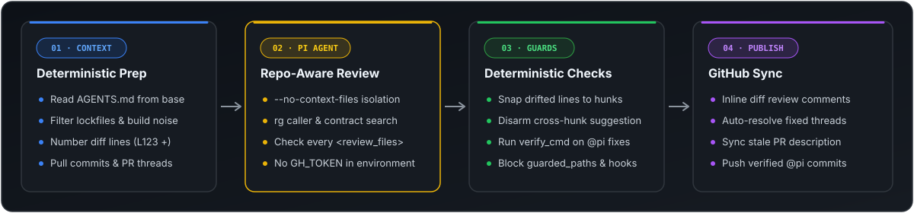

<div align="center">


<br />

[](https://github.com/tripplen23/pi-pr-agent/actions/workflows/ci.yml)
[](https://github.com/tripplen23/pi-pr-agent/releases)
[](https://www.npmjs.com/package/@earendil-works/pi-coding-agent)
[](LICENSE)

**Zero-infrastructure GitHub Action for repository-aware inline PR reviews, 1-click code suggestions, and test-gated `@pi` auto-fixes.**

[Quick Start](#-2-minute-quick-start) · [Commands](#-commands--capabilities) · [How It Works](#-how-it-works-deterministic--agent-hybrid) · [Configuration](#️-configuration--inputs) · [Security](#-security-model) · [Contributing](CONTRIBUTING.md)

</div>

---

## ✨ What It Looks Like on Your PR

<div align="center">
  
</div>

---

## 🧠 Why `pi-pr-agent`?

Generic AI reviewers fail in two predictable ways: **single-call diff wrappers** cannot search callers outside the diff, while **unconstrained general agents** suffer from line-number drift, skipped files on large PRs, and slow token-burning loops.

`pi-pr-agent` combines **deterministic pre/post-processing** with the **[Pi coding agent](https://www.npmjs.com/package/@earendil-works/pi-coding-agent)**:

| Capability | Single-Call Diff Bots | GitHub Copilot Review | **`pi-pr-agent`** |
| :--- | :---: | :---: | :---: |
| Reads `AGENTS.md` / `CLAUDE.md` from **base** branch | ❌ | ⚠️ Partial | ✅ **Enforced & isolated** |
| Searches callers across the full repo (`rg` + `read`) | ❌ | ⚠️ Limited | ✅ **Full worktree access** |
| Pre-numbered `L<num>` diff + lockfile filtering | ❌ | — | ✅ **Zero line-number drift** |
| Multi-line inline comments + 1-click `Commit suggestion` | ⚠️ | ✅ | ✅ **With cross-hunk guard** |
| Remembers prior review threads & author replies | ❌ | ❌ | ✅ **Full `<pr_context>`** |
| Auto-resolves addressed threads on next push | ❌ | ❌ | ✅ **Via GraphQL** |
| Auto-updates empty or stale PR descriptions | ❌ | ❌ | ✅ **Anti-bias sync** |
| `@pi` edits code, runs your test suite & pushes commit | ❌ | 💰 Paid Enterprise | ✅ **Built-in (`verify_cmd`)** |

---

## 🔧 How It Works: Deterministic × Agent Hybrid

<div align="center">
  
</div>

1. **Deterministic Context Preparation (`scripts/fetch_pr_context.py`)**
   - Reads `AGENTS.md` (or `CLAUDE.md`) from the **base** branch (`git show base:AGENTS.md`) so an untrusted PR cannot rewrite its own review checklist.
   - Filters out lockfiles and generated noise (`pnpm-lock.yaml`, `Cargo.lock`, `go.sum`, `*.min.js`, `*.snap`), builds an explicit `<review_files>` checklist, and prefixes every new-side diff line with its exact line number (`L264 + if (existingUser) {`) so the model never miscounts lines from `@@` headers.
   - Fetches PR title, linked GitHub issues (`closingIssuesReferences`), description, full commit messages, CI check status (`statusCheckRollup`), and open/resolved review threads into `<pr_context>`.
2. **Smart Parallel Bundling & Shell-Free Agent Pass (`scripts/run_review.py`)**
   - Small/medium PRs run in a single fast pass; massive PRs (10k+ lines / dozens of files) are deterministically grouped into semantic counterpart bundles (`foo.ts` + `contracts/foo.ts` + `foo.test.ts`) and reviewed concurrently with adaptive timeouts (`review_timeout_minutes: auto`) and graceful partial-coverage recovery.
   - Runs Pi with shell-free read-only tools (`--tools read,grep,find,ls --thinking high`) to verify callers, contracts, and tests across the full repository.
3. **Independent Judge Pass & Deterministic Guards (`prompts/judge.md`, `scripts/post_review.py`)**
   - A fast, tool-free **Fact-Checker / Judge pass** verifies every candidate finding against the exact ground-truth file lines, dropping hallucinations and duplicates before anything reaches GitHub.
   - Deterministically validates `start_line..line` against diff hunks, snaps minor 1–5 line drift, and disarms no-op, placeholder (`// ...`), or unbalanced ` ```suggestion ` blocks so clicking **Commit suggestion** can never corrupt surrounding code.
   - Auto-resolves prior `<!-- pi -->` threads once fixed, syncs stale PR descriptions (`<pr_description>`), and updates the single `<!-- pi-review -->` sticky summary.

---

## 🚀 2-Minute Quick Start

### Step 1 — Add Your Model API Key Secret

Using the GitHub CLI (`gh`), set your [OpenCode Go](https://opencode.ai/console/go), OpenRouter, Anthropic, or OpenAI key on the target repository:

```bash
# If you already connected opencode-go in Pi locally:
pi auth print-api-key --provider opencode-go | tr -d '\r\n' | gh secret set OPENCODE_GO_KEY --repo OWNER/REPO

# Or paste a key interactively:
gh secret set OPENCODE_GO_KEY --repo OWNER/REPO
```

*(Or in the GitHub UI: **Settings → Secrets and variables → Actions → New repository secret** → `OPENCODE_GO_KEY`. For multiple repos in one organization, set it once under **Organization Settings → Secrets and variables → Actions**.)*

### Step 2 — Add `.github/workflows/pi.yml`

Create `.github/workflows/pi.yml` in your repository (see more ready-made templates in [`examples/`](examples/)):

```yaml
name: Pi
on:
  pull_request:
    types: [opened, synchronize, reopened]
  issue_comment:
    types: [created]
  pull_request_review_comment:
    types: [created]

jobs:
  review:
    if: >-
      github.event_name == 'pull_request' &&
      github.event.pull_request.head.repo.full_name == github.repository
    runs-on: ubuntu-latest
    timeout-minutes: 60
    permissions:
      contents: read
      pull-requests: write
    concurrency:
      group: pi-review-${{ github.event.pull_request.number }}
      cancel-in-progress: true
    steps:
      - uses: tripplen23/pi-pr-agent@v1
        with:
          mode: review
          api_key: ${{ secrets.OPENCODE_GO_KEY }}

  command:
    if: >-
      (github.event_name == 'pull_request_review_comment' ||
       (github.event_name == 'issue_comment' && github.event.issue.pull_request)) &&
      contains(fromJSON('["OWNER","MEMBER","COLLABORATOR"]'), github.event.comment.author_association) &&
      github.event.comment.user.type != 'Bot'
    runs-on: ubuntu-latest
    timeout-minutes: 60
    permissions:
      contents: write
      pull-requests: write
      issues: write
    concurrency:
      group: pi-cmd-${{ github.event.issue.number || github.event.pull_request.number }}
      cancel-in-progress: false
    steps:
      - uses: tripplen23/pi-pr-agent@v1
        with:
          mode: comment
          api_key: ${{ secrets.OPENCODE_GO_KEY }}
          # Replace with your repo's test command (e.g. "cargo test", "go test ./...", "pytest"):
          verify_cmd: "pnpm typecheck && pnpm lint && pnpm test"
```

> **macOS / Swift projects**: keep `review` on `ubuntu-latest` (fast & low-cost) and run `command` on `macos-15` so `swift test` gates `@pi` commits — see [`examples/swift-macos.yml`](examples/swift-macos.yml).

### Step 3 — Merge to Default Branch (`main` / `master`)

- **Automatic PR review (`pull_request`)** works immediately — including on the PR that adds `.github/workflows/pi.yml`.
- **Interactive comment commands (`issue_comment`, `pull_request_review_comment`)** activate as soon as `.github/workflows/pi.yml` lands on your default branch.

---

## 💬 Commands & Capabilities

Comment any of these in the **PR conversation**, inside an **inline diff review thread**, or at the bottom of a **Quote reply**:

| Trigger / Command | Mode | What it does |
| :--- | :--- | :--- |
| **PR open / sync** *(or `/review`, `@pi /review`)* | Read-only | Reviews `base...HEAD` against `AGENTS.md` / `CLAUDE.md`, posts inline diff comments (`start_line..line`) with colored `High` / `Medium` / `Low` badges and 1-click `suggestion` blocks, auto-resolves fixed threads, syncs stale PR descriptions, and updates the sticky `<!-- pi-review -->` summary. |
| **`/describe`** *(or `@pi /describe`)* | Read-only | Generates a structured PR summary (`Type`, overview, and file-by-file walkthrough table) and updates the PR description. |
| **`/improve`** *(or `@pi /improve`)* | Read-only | Scans the PR diff for self-contained code improvements and posts inline committable ` ```suggestion ` blocks. |
| **`/ask <question>`** *(or `@pi /ask ...`)* | Read-only | Answers questions about the PR or surrounding codebase directly in the conversation or diff review thread, citing exact `path:line` references. |
| **`@pi <instruction>`** *(or `/fix ...`, `/pi ...`)* | Write + Gate | Edits the PR branch to address the request, runs your `verify_cmd` test gate, blocks changes to `guarded_paths`, and commits + pushes to the PR branch. |

---

## ⚙️ Configuration & Inputs

| Input | Default | Description |
| :--- | :--- | :--- |
| `mode` | `auto` | `review`, `comment` (`fix`), or `auto` (`pull_request` → review, comment events → slash/`@pi` commands). |
| `api_key` | *(required)* | API key for the model provider. |
| `api_key_env` | `OPENCODE_API_KEY` | Environment variable Pi reads for the provider key (`OPENCODE_API_KEY`, `OPENROUTER_API_KEY`, `ANTHROPIC_API_KEY`, `OPENAI_API_KEY`, etc.). |
| `model` | `opencode-go/deepseek-v4.1-flash` | Model ID passed to `pi --model`. |
| `fallback_model` | `opencode-go/glm-5.3-flash` | Fallback model tried automatically when `model` is overloaded (`429`/`5xx`). |
| `thinking` | `high` | Thinking depth (`off`, `minimal`, `low`, `medium`, `high`). |
| `review_timeout_minutes` | `auto` | Review timeout budget in minutes, or `auto` to scale dynamically with PR size (20m on small PRs up to 85m on massive multi-bundle PRs). |
| `fix_timeout_minutes` | `45` | Timeout in minutes for interactive `@pi` / `/fix` commands. |
| `max_parallel_bundles` | `3` | Max concurrent Pi workers when reviewing large multi-bundle PRs (> 10 files or > 1,800 changed lines). |
| `judge_pass` | `true` | Run an independent tool-free fact-checker pass to drop hallucinated or duplicate findings. |
| `skip_bots` | `true` | Skip automatic `pull_request` reviews when the PR author is a bot (e.g. Renovate, Dependabot). |
| `skip_drafts` | `false` | Skip automatic `pull_request` reviews while the PR is in draft state. |
| `rubric_file` | `AGENTS.md` | File read from the **base** branch as the system-prompt rubric (falls back to `CLAUDE.md` if absent). |
| `extra_instructions` | `""` | Extra repository-specific review/fix rules appended to the prompt. |
| `setup_cmd` | `""` | Shell command run in a secret-free step before a `@pi` / `/fix` edit (e.g. `corepack enable pnpm && pnpm install --frozen-lockfile`). |
| `verify_cmd` | `""` | Shell command that must pass before a `@pi` / `/fix` edit is committed and pushed. |
| `guarded_paths` | `.github .woodpecker Dockerfile ...` | Space-separated paths that `@pi` / `/fix` is forbidden from staging or pushing. |
| `github_token` | `${{ github.token }}` | Token used to post reviews/comments and push fixes. |

### Customizing the Rubric per Repo

1. **Zero-config (`AGENTS.md` / `CLAUDE.md`)** — `pi-pr-agent` automatically loads `AGENTS.md` (or `CLAUDE.md`) from your base branch into Pi's system prompt.
2. **Inline rules (`extra_instructions`)** — pass `extra_instructions:` in `with:` for quick repo-specific checks.
3. **Full prompt override** — commit `.github/pi-review-prompt.md` or `.github/pi-fix-prompt.md` to your default branch to replace the built-in prompt while keeping the inline diff publisher and thread sync.

---

## 🔒 Security Model

See [SECURITY.md](SECURITY.md) for the full threat model. Key invariants:

- **Base-branch rubric isolation** — `AGENTS.md` / `CLAUDE.md` and custom prompt files are read from `base` via `git show`, and Pi runs with `--no-context-files --no-approve`. A PR cannot poison its own review checklist or auto-load `.pi/` extensions.
- **Step-scoped credentials** — `github_token` is never exposed to the step that runs Pi or project tests; `api_key` is scoped strictly to the `pi` invocation step and literally redacted (`perl \Q...\E`) from all published output.
- **Git hook & path guards** — before committing a `@pi` fix, `.git/hooks`, `core.fsmonitor`, and `core.hooksPath` are cleared, default branches (`main`/`master`) are refused, and any staged change touching `guarded_paths` aborts the push.

---

## 🤝 Contributing & License

Contributions, bug reports, and prompt improvements are welcome! See [CONTRIBUTING.md](CONTRIBUTING.md) for local development and testing instructions.

Licensed under the [MIT License](LICENSE).
